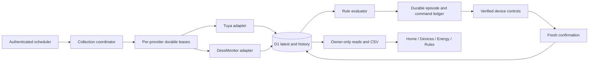

# Photon technical guide

This guide describes the coordinated actual-energy upgrade. Deployment evidence and outstanding gates live in photon-upgrade-progress.md. Do not interpret local tests as proof of live provider operation.

## Architecture and access

Photon serves one household and its configured owner through Sites, a Cloudflare-compatible Vinext/React worker and D1. Public hosting does not grant data access: the root layout and data APIs use getOwnerUser; mutations also enforce same origin. Existing authentication, credentials, Android wrapper, notification delivery, rooms, preferences and favorites remain in place.

lib/providers/registry.ts defines adapter access and provider-qualified references without changing legacy external IDs. Tuya supplies smart-device capabilities and commands. DessMonitor supplies read-only inverter telemetry. Google Home has no active adapter, credentials or fabricated support.

| Boundary | Implementation |
| --- | --- |
| Owner and origin checks | lib/owner-auth.ts |
| Durable jobs, throttling, request accounting | lib/jobs.ts, lib/provider-policy.ts |
| Collection and historical cursors | lib/collection.ts, lib/solar-store.ts, lib/tuya-store.ts |
| Measurement normalization | lib/measurements.ts, lib/tuya-format.ts |
| Actual-energy provenance | lib/actual-energy.ts, lib/telemetry.ts, lib/solar-energy.ts |
| Rule matching and safety | lib/automation-types.ts, lib/automations.ts |
| Command delivery and reconciliation | lib/commands.ts |
| Activity history | lib/automation-activity.ts |
| Cutover validation | lib/release-check.ts |
| Persistent mobile navigation | components/app-shell.tsx, hooks/use-app-navigation.ts |
| Offline account isolation | components/mobile-support.tsx, public/sw.js |

## APIs

Ordinary GETs, exports and rule previews read saved data, never trigger provider polling.

- GET /api/devices returns compatible Tuya device fields, provider/ref identities and effective synchronization policy.
- GET /api/devices/tuya/:id/energy?range=7|30|months returns measured kWh, calendar buckets, partial coverage and null missing values.
- POST /api/devices/tuya/:id/command accepts code/value and returns command ID, requested state and durable delivery status. Fresh confirmation is saved into latest state; accepted is not the same as confirmed.
- POST /api/devices/refresh performs an optional budget-gated foreground refresh, sharing the collector lease. It returns scheduled when acceleration is unavailable.
- GET /api/automations/activity supports rule, status, from, to and cursor. Pages contain at most 50 records; dates use Pakistan-local midnight, IDs provide stable descending pagination.
- Existing /api/tuya routes retain their compatibility services. /api/solar/latest, /history and /reports use D1; reports preserve selected historical years.
- POST /api/mobile/collect remains the single authenticated external scheduler target. Preserve its existing collection-secret header; do not put secrets in URLs.

## Cadence and request budget

The coordinator permits a one-minute tick, with independent provider jobs. DessMonitor stays at five minutes. Tuya stays at five minutes unless its entitlement is verified. An external five-minute scheduler still bounds effective latency to five minutes; changing the internal lease alone does not accelerate the scheduler.

Optional runtime settings are TUYA_MONTHLY_ALLOWANCE, TUYA_ENTITLEMENT_EXPIRES (parseable future timestamp), TUYA_EXTERNAL_MONTHLY_CALLS, TUYA_POLL_SECONDS (minimum 60) and TUYA_FOREGROUND_REFRESH=true. Do not configure these from a generic advertised allowance: confirm the actual project, expiry, billing window and other consumers first. The present budget uses UTC calendar months; a different provider billing window requires adaptation before enabling acceleration.

The ledger seeds from recorded current-month requests, reserves atomically before calls, retains 20% capacity for commands/confirmation/authentication and paces discretionary traffic through the month. History has a lower ceiling. Throttled calls do not consume a reservation. Failed network attempts do count conservatively. Unverified entitlement preserves the prior cadence and does not claim to enforce an unknown contractual limit. No paid provider features or message-consumer service are added.

The device UI uses two expected intervals plus one minute to label stale observations. Automation numeric inputs retain a ten-minute maximum age. Switch observations use collection freshness so an unchanged value need not be mistaken for an old measurement. Source timestamps remain distinct from collection times.

## Actual energy and history

A null means unavailable, never zero. Verified zero is retained. Tuya daily consumption accepts known cumulative-energy codes with normalized kWh units and nonnegative within-day counter differences. Counter decreases and cross-day intervals are excluded; repeated incremental datapoints are not summed. Power integrals may support average-power statistics but never consumption, consumption comparisons or exported kWh.

Solar production uses provider period totals or observed daily counters. A missing-counter day cannot contribute a power-derived estimate to a measured total. Counter discontinuities mark partial coverage. Grid consumption requires provider-measured energy; home load, battery energy, direct-solar savings, cycles and health remain unavailable when the source cannot measure them. SOC, voltage, current and instantaneous power remain useful measured history. Tariff costs are clearly estimates applied to measured energy, with provisional coverage disclosed.

Provider years are discovered first; historical month and then day totals are repaired one period per maintenance pass. period_coverage records available/empty states only after persistence. Failures remain retryable. Monthly charts always have twelve calendar positions; absent months stay null. A successful backfill request does not prove the provider has data for every historical period.

Detailed data and hourly summaries retain 90 days. Permanent daily/monthly/yearly summaries retain provenance and coverage. Calculation version 3 removes power-derived consumption. repairActualEnergyStep processes one old daily summary per maintenance pass; unrecoverable estimates become unavailable, with originals retained in upgrade_backup. Retention verifies permanent summaries before removing raw detail.

## Rules and commands

Operators >, >=, <, <= and equals are explicit. Legacy above/below retain inclusive behavior and normalize on save. Enabling a rule rearms its episode; the next fresh matching observation can act once, subject to duration, cooldown, global pause and channel overrides. Ordinary edits preserve episodes. Repeated matching readings never replay a completed episode. Recovery rearms only after its configured observations match.

Rule saves share the evaluator lease; re-enable state and configuration commit atomically. The episode, run, pending actions and trigger activity commit before physical commands. Commands use verified capabilities, durable channel locks, duplicate suppression and ten-minute confirmation expiry. Manual control reserves a one-hour channel override. Uncertain delivery is not retried automatically.

Activity stores rule snapshots, current/previous observations, evaluation reason and correlated command transitions. Identical evaluation fingerprints are suppressed. Details retain 90 days, with daily status counts retained indefinitely. The latest evaluation is distinct from a successful action. Existing household rule values are preserved; the brief's example threshold is not permission to alter a live rule.

## Chart audit

| View | Decision and user question | Source / calculation / unit | Range and missing-data behavior |
| --- | --- | --- | --- |
| Home energy flow | Keep; where is power going now? Make nodes open details | Saved inverter readings, W/kW and SOC % | Latest observation, freshness displayed |
| Production and demand | Keep under Energy history | Saved power samples, W; averages for aggregated display | Selected history, gaps remain gaps |
| Solar/grid energy bars | Keep; how much measured energy by period? | Provider period totals and verified counters, kWh | Week/month/year; twelve historical-month positions |
| SOC history | Keep; how does charge vary? | Valid BMS SOC, %; communication-zero anomalies become null | Saved history; gaps not connected |
| Battery window | Keep; charge relative to reserve | SOC and configured reserve, percentage points | Latest; no capacity-based energy claim |
| Operating statistics | Keep supported SOC/range/time; suppress unsupported energy/cycles | SOC extrema and observed reserve duration; hours | Partial coverage labeled, unavailable shown as dash |
| Generic device datapoint chart | Replace with focused energy view | Verified counter summaries, kWh | 7/30 daily bars and calendar months; coverage table |
| Battery/solar/grid/home detail | Add; inspect one system component | Saved measured electrical/SOC fields | Today/7/30 days; power is not consumption |
| Appliance/room reports and CSV | Keep with actual-only gate | Same measured summaries and filters; upstream meters excluded from room sum | Selected periods, partial comparisons disclosed |
| Direct solar savings | Retain layout but unavailable without measured direct energy | Existing tariff model cannot establish unmeasured routing | No fabricated zero savings or energy |

## Offline and development

Cache protocol photon-v2-actual-energy invalidates older estimated report copies. Saved pages and API responses are account- and query-scoped; unauthorized responses clear private copies. Offline writes fail without a deferred command queue. Local development bypasses service-worker registration so hot-reload modules cannot mix React versions; production retains offline support.

The combined site.css imports globals followed by photon-ui.css to preserve cascade. The development middleware serves raw CSS for stylesheet requests; production uses built assets. Keep deployment thumbnails unchanged unless explicitly requested.

## Release and rollback

Migrations 0008/0009 are additive. upgrade_backup snapshots rules, state, settings, rooms, preferences, favorites and derived energy; it is an in-database rollback snapshot, not an independent disaster-recovery export. Existing raw history and credentials are not modified by these migrations. Preserve the prior Sites version and schema when rolling the application back.

For a populated rules database, migration 0009 records the prior global pause state and pauses automation. A successful new-worker collection dry-runs enabled configurations against fresh observations, restores the saved pause state and defers actual evaluation until the next tick. Invalid or stale readings keep the gate paused. Inspect release_control/photon-v2 in upgrade_backup if it remains pending; do not blindly enable rules to bypass failed validation.

Verify the deployment version and migration tables, then inspect app_jobs, connection_state, collection runs, automation_activity and period_coverage across at least three scheduled cycles. Physical validation requires a specifically approved test device; automated regression tests use fake devices. Production browser access, a reference-phone timing baseline, exact quota entitlement and historical completeness are separate evidence gates.

If rollback is required, pause rules, redeploy the prior verified Sites version, keep additive tables and backups, and reconcile pending command records before resuming. Never replay uncertain commands or restore old episode state over newly completed actions. Restore a summary snapshot only after reviewing its date/source and retaining the newer record.
